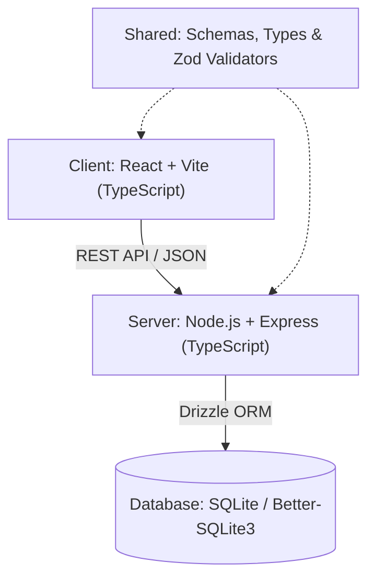

# Global Bridge — وثيقة المعمارية التقنية (Architecture Document)

**تاريخ التوثيق:** أكتوبر 2026  
**الإصدار:** 1.0 (MVP)  
**الحالة:** معتمد للتنفيذ  

---

## 1. فحص الحالة والبيئة الحالية (Environment Assessment)

| العنصر | الحالة المكتشفة | التوصيف والقرار |
| :--- | :--- | :--- |
| **نظام التشغيل (OS)** | Windows (x64) | بيئة التطوير الأساسية للمستخدم. |
| **Node.js** | `v20.20.0` (LTS) | إصدار مستقر ومدعوم بالكامل مع دعم Native Fetch وESM. |
| **مدير الحزم (Package Manager)** | `pnpm` (الإصدار `12.15.0`) + `npm` (`10.8.2`) | تم تفعيل مسار `pnpm` العالمي لسرعة التثبيت وكفاءة الـ caching. |
| **حالة المستودع (Workspace)** | مجلد نظيف من الصفر | لا توجد حزم قديمة أو تعارضات؛ نبدأ ببنية نقية ومنظمة. |
| **ملف package.json** | غير منشأ بعد | سيتم إنشاؤه في المهمة التالية Task 03 بالأوامر والـ scripts القياسية. |

---

## 2. المكدس التقني المعتمد (Selected Technology Stack)

تم اختيار تقنيات موحدة بـ **TypeScript** الكامل من الواجهة حتى قاعدة البيانات، لتوفير أقصى استقرار وأمان في الأنواع (End-to-End Type Safety):



### 2.1 الـ Frontend Stack
* **Framework / Bundler:** React 18 / 19 مع **Vite** لسرعة البناء والـ HMR اللحظي.
* **Language:** TypeScript (`strict: true`).
* **Routing:** مسارات خفيفة وسريعة (Wouter أو React Router DOM) تدعم مسارات الـ Public والـ Dashboards والـ Nested Layouts.
* **Styling:** CSS نقي وعصري (Vanilla Modern CSS) مع CSS Variables لـ Design Tokens الخاصة بالهوية المصرية (`--nile-blue`, `--egypt-gold`, `--cairo-ink`, `--sand-white`) دون الاعتماد القسري على مكتبات ضخمة، مع دعم كامل للـ Dark Mode.
* **Icons:** SVG Components مخصصة مبنية على حزمة شعارات Global Bridge وأيقونات مدمجة خفيفة.

### 2.2 الـ Backend Stack
* **Runtime:** Node.js (v20+).
* **Server Framework:** **Express.js** مع TypeScript لدعم المرونة الكاملة وسهولة فحص ومراقبة الـ Endpoints.
* **Port Strategy:** تشغيل الخادم على المضيف `0.0.0.0` وقراءة المنفذ من المتغير `process.env.PORT` مع استخدام `3000` كقيمة افتراضية (Fallback).
* **Health Check:** مسار عام غير محمي `GET /api/health` يعيد كود `HTTP 200` مع بيانات حالة الخادم ووقت التشغيل.

### 2.3 الـ Database & ORM Stack
* **Database Engine:** **SQLite** عبر محرك `better-sqlite3` للـ MVP.
  - *المبرر:* محرك مدمج، فائق السرعة، لا يحتاج تشغيل خادم خارجي (Zero-daemon)، مستقر 100% على Windows، ويجعل تشغيل الـ Seed والـ Migrations لحظياً، مع إمكانية التحويل المستقبلي إلى PostgreSQL عبر تعديل طفيف في الـ Driver فقط.
* **ORM:** **Drizzle ORM** مع `drizzle-kit`.
  - *المبرر:* أفضل أداء، استخراج تلقائي لـ TypeScript Types من الـ Schema، ودعم ممتاز لكل من SQLite وPostgres.

### 2.4 أسلوب الـ API (API Style)
* **RESTful JSON API** مع التحقق بواسطة مكتبة **Zod**:
  - استدعاءات صريحة وسهلة الاختبار عبر المتصفح وأدوات الفحص.
  - مشاركة نماذج التحقق (Validation Schemas) والأنواع (Types) بين الخادم والعميل من خلال مجلد `shared/`.
  - مسارات مجمعة منطقياً: `/api/public/*`, `/api/company/*`, `/api/admin/*`, `/api/auth/*`.

### 2.5 أسلوب المصادقة في الـ MVP (Authentication Approach)
* **Session-based / Demo RBAC:**
  - دعم الأدوار الثلاثة: `candidate`, `company`, `admin`.
  - توفير **Demo Workspaces** سريعة التبديل (حساب شركة تجريبية Northstar Labs، وحساب مدير المنصة) بضغطة زر لاختبار وفحص لوحات التحكم مباشرة دون عوائق إعداد.
  - التحقق المزدوج من الصلاحيات: في الواجهة (Route Guards) وفي الخادم (Backend Middleware & Ownership Checks).

---

## 3. بنية وتنظيم المجلدات (Folder Structure)

```text
D:\Gloabl\
├── brand/                    # حزمة الهوية البصرية وشعارات SVG ومعرض الهوية
├── client/                   # تطبيق الواجهة الأمامية (Frontend)
│   ├── public/               # الأصول العامة وmanus-routes.json وfavicon
│   └── src/
│       ├── assets/           # صور ومكونات SVG للهوية
│       ├── components/       # مكونات الـ UI المشتركة (Button, Card, Modal, إلخ)
│       ├── layouts/          # هياكل الصفحات العامة ولوحات التحكم
│       ├── pages/            # صفحات الموقع (Home, Jobs, Company, Admin, إلخ)
│       ├── services/         # استدعاءات الـ API والـ Fetchers
│       ├── index.css         # الـ Design System وتعاريف ألوان الهوية المصرية
│       └── App.tsx           # المكون الرئيسي ومسارات التوجيه
├── server/                   # تطبيق الخادم والـ Backend
│   ├── src/
│   │   ├── db/               # اتصال قاعدة البيانات والـ Seed
│   │   ├── middleware/       # التحقق من الصلاحيات والـ Logger
│   │   ├── routes/           # مسارات الـ API (public, company, admin, health)
│   │   ├── services/         # منطق الأعمال واستعلامات الـ DB
│   │   └── index.ts          # نقطة انطلاق الخادم وتشغيل الـ Port
├── shared/                   # الأكواد والأنواع المشتركة بين العميل والخادم
│   ├── schema.ts             # جداول Drizzle Schema والعلاقات
│   └── types.ts              # نماذج البيانات والـ Interfaces
├── .env.example              # نموذج متغيرات البيئة بدون قيم سرية
├── architecture.md           # هذا الملف (توثيق المعمارية)
├── package.json              # تعريف الحزم والأوامر المشتركة
├── tsconfig.json             # إعدادات TypeScript
└── README.md                 # دليل التشغيل والتثبيت
```

---

## 4. أوامر التشغيل والبناء (Scripts & Commands)

| الأمر | الوظيفة |
| :--- | :--- |
| `pnpm dev` | تشغيل خادم التطوير مع الـ Hot Reload للواجهة والخادم على المنفذ `3000`. |
| `pnpm build` | بناء أصول الواجهة (Vite build) وترجمة كود الخادم إلى حزمة إنتاجية جاهزة. |
| `pnpm check` | تشغيل فحص شامل للأنواع `tsc --noEmit` للواجهة والخادم والـ Shared. |
| `pnpm db:push` | تطبيق الـ Schema مباشرة على قاعدة بيانات SQLite. |
| `pnpm db:seed` | تعبئة قاعدة البيانات بالشركات والوظائف والمتقدمين التجريبيين. |

---

## 5. سياسة الأسرار وحماية البيانات (Secrets & Environment Variables)

### 5.1 ما يحتاج Secrets وما لا يحتاجه
* **ما لا يحتاج Secrets في الـ MVP:**
  - منفذ التشغيل `PORT=3000`.
  - اسم ملف قاعدة البيانات المحلية `DATABASE_URL=sqlite.db`.
  - معرفات ومسميات الشركات والوظائف والتدريبات التجريبية.
* **ما يحتاج حماية وأسرار (`.env` مستبعد من Git):**
  - مفتاح تشفير الجلسات `SESSION_SECRET` (يتم توليده تلقائياً أو إدخاله محلياً).
  - أي مفاتيح مستقبلية لبوابات إرسال البريد أو التخزين السحابي للـ CVs.

---

## 6. الخلاصة والقرار الفني
تضمن هذه المعمارية خفة استثنائية، وسرعة دوران مذهلة في التطوير، وتحكماً كاملاً في مظهر وهوية المنصة المصرية، مع تلبية كافة متطلبات خطة العمل ومسارات الفحص بنسبة 100%.
